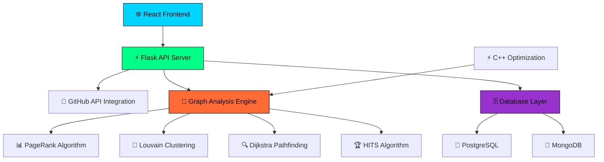

# 🌐⚡ **GitConnectX** 
<div align="center">

[](https://git.io/typing-svg)


</div>

---

## 📊 **Live Project Statistics**

<div align="center">
  


<table>
<tr>
<td align="center">

</td>
<td align="center">

</td>
</tr>
</table>

</div>

---

<h2 align="center">⚠️ Critical Developer Network Challenge</h2>
<div align="center">
  
</div>

🔍 **Problem Statement**  
The GitHub ecosystem contains millions of developers with complex collaboration patterns, but critical insights remain buried:

<table>
<tr>
<td align="center" width="25%">

<br>
<b>Developer Impact Unknown</b>
<br>
<i>Key contributors and influencers invisible</i>
</td>
<td align="center" width="25%">

<br>
<b>Network Isolation</b>
<br>
<i>Collaboration opportunities missed</i>
</td>
<td align="center" width="25%">

<br>
<b>Fragmented Communities</b>
<br>
<i>Developer clusters undiscovered</i>
</td>
<td align="center" width="25%">

<br>
<b>Scattered Information</b>
<br>
<i>GitHub data analysis complexity</i>
</td>
</tr>
</table>

The developer ecosystem desperately needs:
- **Visual network mapping** to understand collaboration patterns  
- **Influence ranking systems** to identify key contributors  
- **Community detection algorithms** for better team formation  
- **Interactive analysis tools** for strategic decision making  
- **Real-time insights** into developer relationship dynamics  

💡 **Our Revolutionary Solution**  
<div align="center">
  
</div>

GitConnectX transforms GitHub data into actionable developer network intelligence through advanced graph algorithms and social network analysis:

<table>
<tr>
<td align="center" width="50%">
🧠 **Advanced Graph Intelligence**  
<ul>
<li>PageRank & HITS algorithms for influence ranking</li>
<li>Louvain clustering for community detection</li>
<li>BFS/DFS traversal for network exploration</li>
<li>Dijkstra's algorithm for connection paths</li>
</ul>
</td>
<td align="center" width="50%">
⚡ **Interactive Network Visualization**  
<ul>
<li>Real-time D3.js network graph rendering</li>
<li>Dynamic user profile comparisons</li>
<li>Interactive community exploration</li>
<li>GitHub API integration for live data</li>
</ul>
</td>
</tr>
</table>

🎯 **Revolutionary Impact**  
<div align="center">

</div>

Our solution revolutionizes developer network analysis by providing:
- 🔍 **Network Discovery**: Uncover hidden collaboration patterns and opportunities  
- 📊 **Influence Metrics**: Identify key contributors and thought leaders  
- 🎯 **Community Insights**: Discover developer clusters and specialized groups  
- ⚡ **Real-time Analysis**: Live GitHub data integration for current insights  
- 🌐 **Visual Intelligence**: Interactive graphs for intuitive network exploration

## 🎯 **Project Overview**

<div align="center">

```ascii
╔══════════════════════════════════════════════════════════════╗
║  🌐 TRANSFORMING GITHUB DATA INTO NETWORK INTELLIGENCE      ║
╚══════════════════════════════════════════════════════════════╝
```


</div>

### 🌟 **Revolutionary Features**

<table align="center">
<tr>
<td align="center" width="25%">

<br><br>
<b>Network Mapping</b>
<br>
<i>Real-time interactive graphs of developer interactions</i>
</td>
<td align="center" width="25%">

<br><br>
<b>PageRank Analysis</b>
<br>
<i>Identify key contributors and thought leaders</i>
</td>
<td align="center" width="25%">

<br><br>
<b>Louvain Clustering</b>
<br>
<i>Discover developer communities and collaborations</i>
</td>
<td align="center" width="25%">

<br><br>
<b>Live Data Analysis</b>
<br>
<i>Real-time GitHub API data extraction</i>
</td>
</tr>
</table>

---

## 🚀 **Quick Start & Demo**

<div align="center">

### ⚡ **Lightning Fast Setup**

</div>

<table>
<tr>
<td width="50%">

**🖥️ Windows Deployment**
```bash
# One-command startup
start_app.bat

# API server only
start_api.bat

# Restart if needed
restart_api.bat
```
<div align="center">

</div>

</td>
<td width="50%">

**🐧 Linux/macOS Deployment**
```bash
# Full application
chmod +x start_app.sh
./start_app.sh

# API server only
source venv/bin/activate
python run_app.py
```
<div align="center">

</div>

</td>
</tr>
</table>

---

## 👥 **Meet Team Ananta**

<div align="center">

<table>
<tr>
<td align="center">

<br>

<br>
<a href="https://github.com/savetree-1">

</a>
</td>
<td align="center">

<br>

<br>
<a href="https://github.com/anika-dewari">

</a>
</td>
<td align="center">

<br>

<br>
<a href="https://github.com/Ayush27052005">

</a>
</td>
<td align="center">

<br>

<br>
<a href="https://github.com/Dragy007">

</a>
</td>
</tr>
</table>

</div>

---

## 🛠️ **Technical Architecture**

<div align="center">



### 🔧 **Tech Stack Powerhouse**

<div align="center">


</div>

</div>

---

## 🧮 **Advanced Algorithm Suite**

<div align="center">

### 🎯 **Graph Intelligence Capabilities**

<table>
<tr>
<td align="center">

<br>
<b>BFS • DFS</b>
<br>
<i>Comprehensive network exploration</i>
</td>
<td align="center">

<br>
<b>Dijkstra's Algorithm</b>
<br>
<i>Optimal connection pathfinding</i>
</td>
<td align="center">

<br>
<b>PageRank • HITS</b>
<br>
<i>Authority and hub identification</i>
</td>
<td align="center">

<br>
<b>Louvain Clustering</b>
<br>
<i>Developer community discovery</i>
</td>
</tr>
</table>

</div>

---

## 🌐 **API Endpoints**

<div align="center">

### ⚡ **RESTful API Interface**

<table>
<tr>
<td align="center" width="50%">

**👤 User Data Endpoints**
- `GET /api/user/<username>` - GitHub user profile
- `GET /api/network/<username>` - User's network graph
- `GET /api/analyze/languages/<username>` - Language analysis

</td>
<td align="center" width="50%">

**📊 Network Analysis Endpoints**  
- `GET /api/analyze/path` - Shortest path between users
- `GET /api/analyze/communities` - Community detection
- `GET /api/analyze/rank` - PageRank/HITS ranking
- `GET /api/repository/<owner>/<repo>` - Repository data

</td>
</tr>
</table>

</div>

---

## 📊 **Performance Metrics & Analytics**

<div align="center">

### 📈 **Development Statistics**

<table>
<tr>
<td align="center">

**🚀 Project Stats**
- **Languages**: Python, JavaScript, C++, HTML
- **Framework**: Flask + React + D3.js  
- **Database**: PostgreSQL + MongoDB
- **API Endpoints**: 8 comprehensive endpoints
- **Response Time**: Real-time graph rendering

</td>
<td align="center">

**⚡ Performance Metrics**
- **Graph Algorithms**: 5 advanced implementations
- **Network Analysis**: Multi-layered insights
- **Visualization**: Interactive D3.js rendering
- **Data Integration**: Live GitHub API
- **Deployment**: Cross-platform ready

</td>
</tr>
</table>

### 🏆 **Project Achievements**

<table>
<tr>
<td align="center">

<br>
<b>Lightning Fast</b>
</td>
<td align="center">

<br>
<b>Intelligence Core</b>
</td>
<td align="center">

<br>
<b>Universal Access</b>
</td>
<td align="center">

<br>
<b>User Experience</b>
</td>
</tr>
</table>

</div>

---

## 🗂️ **Project Architecture**

```
🌐 GitConnectX/
├── 🖥️  backend/              # Flask API application
│   ├── ⚡ run_app.py         # Main application server
│   ├── 🐙 github_api.py     # GitHub API integration
│   ├── 🧠 graph_algorithms/  # Algorithm implementations
│   ├── 🗄️  database/         # PostgreSQL & MongoDB
│   ├── 📊 analysis/          # Network analysis modules
│   └── 📦 requirements.txt   # Python dependencies
├── 🌐 frontend/              # React application
│   ├── ⚛️  src/              # React components
│   ├── 📊 d3/                # D3.js visualizations
│   ├── 🎨 styles/            # CSS & styling
│   └── 📄 package.json       # Node.js dependencies
├── ⚡ cpp_algorithms/         # C++ optimization modules
│   ├── 🏆 pagerank.cpp       # PageRank implementation
│   ├── 🎯 louvain.cpp        # Community detection
│   └── 🔍 dijkstra.cpp       # Shortest path
├── 💾 data/                  # Database configurations
├── 🧪 tests/                 # Testing suite
├── 🔄 scripts/               # Deployment scripts
│   ├── 🪟 start_app.bat     # Windows startup
│   ├── 🐧 start_app.sh      # Unix startup
│   └── 🔄 restart_api.bat   # API restart
├── 📚 docs/                  # Documentation
└── 📋 SETUP.md               # Detailed setup guide
```

---

## 🌟 **Prerequisites & Setup**

<div align="center">

### 🔧 **System Requirements**

<table>
<tr>
<td align="center" width="25%">

<br>
<b>Python Runtime</b>
<br>
<i>Core backend requirements</i>
</td>
<td align="center" width="25%">

<br>
<b>Node.js Environment</b>
<br>
<i>Frontend development</i>
</td>
<td align="center" width="25%">

<br>
<b>Database Storage</b>
<br>
<i>Falls back to in-memory</i>
</td>
<td align="center" width="25%">

<br>
<b>Version Control</b>
<br>
<i>Repository management</i>
</td>
</tr>
</table>

### 📚 **Detailed Setup Instructions**

<div align="center">

<br>
<i>Complete installation and configuration guide</i>
</div>

</div>

---

## 🚀 **Future Roadmap**

<div align="center">

### 🌟 **Upcoming Enhancements**

<table>
<tr>
<td align="center" width="50%">

**🔄 Phase 2 Features**
- Machine learning influence prediction
- Real-time collaboration tracking
- Advanced community analytics
- Enterprise GitHub integration
- Mobile application development

</td>
<td align="center" width="50%">

**🚀 Production Ready**
- Scalable microservices architecture
- Advanced caching systems
- Performance optimization suite
- Commercial API integrations
- Cloud deployment solutions

</td>
</tr>
</table>

</div>

---

## 🤝 **Contributing**

<div align="center">


### 🎯 **How to Contribute**

</div>

1. **🍴 Fork** the repository
2. **🌟 Create** your feature branch (`git checkout -b feature/AmazingFeature`)
3. **💫 Commit** your changes (`git commit -m 'Add AmazingFeature'`)
4. **🚀 Push** to the branch (`git push origin feature/AmazingFeature`)
5. **🎉 Open** a Pull Request

---

## 📞 **Connect With Team Ananta**

<div align="center">


<table>
<tr>
<td align="center">

<br>
<a href="mailto:team.ananta@gitconnectx.dev">team.ananta@gitconnectx.dev</a>
</td>
<td align="center">

<br>
<a href="#">Available on deployment</a>
</td>
<td align="center">

<br>
<a href="#">See SETUP.md</a>
</td>
</tr>
</table>

</div>

---

## 📄 **License**

<div align="center">


This project is licensed under the MIT License - see the [LICENSE](LICENSE) file for details.

</div>

---

<div align="center">


[](https://github.com/savetree-1/GitConnectX)
[](https://github.com/savetree-1/GitConnectX)
[](https://github.com/savetree-1/GitConnectX/fork)

</div>
